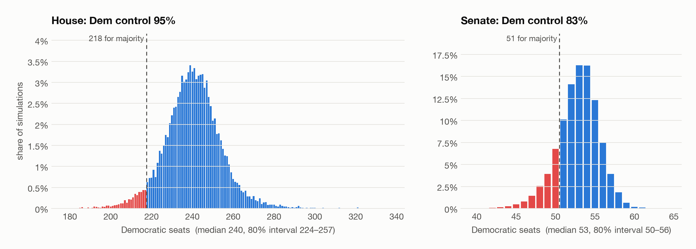
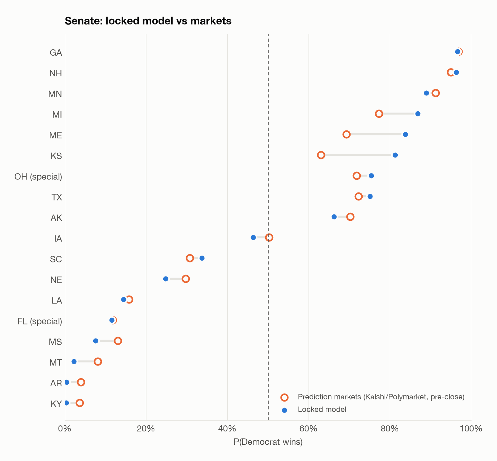
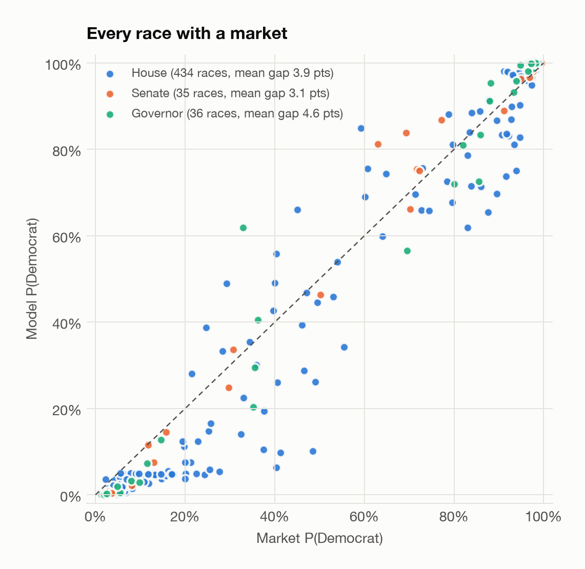
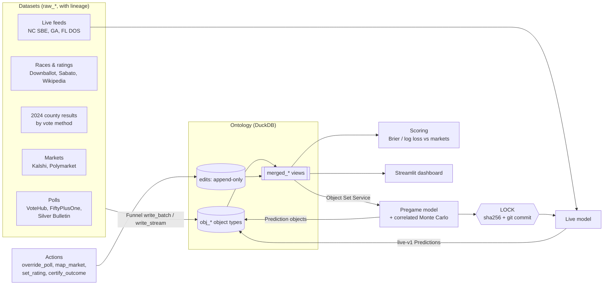
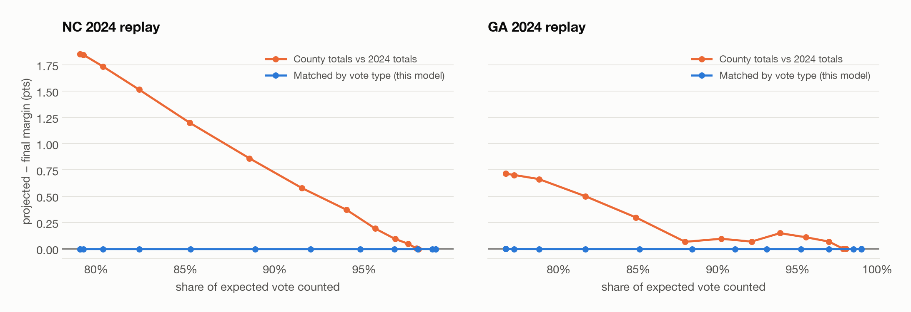

# Election Twin

**A live digital twin of the 2026 U.S. midterms, built on a Palantir Foundry-style ontology.**

Polls, prediction markets, 2024 results, ratings and live county vote counts all resolve to the same typed
objects (`Race`, `County`, `Poll`, `Market`, `VoteBatch`, `Prediction` …). A correlated Monte Carlo turns those
objects into race and chamber odds. Those odds are written back to the ontology, locked and hashed. On election night
they're updated from county returns, and after the election they're scored against the markets.

Built in one day, on election day (2026-11-03).

<p align="center">
  <picture>
    <source media="(prefers-color-scheme: dark)" srcset="docs/img/seats-dark.png">
    
  </picture>
</p>

## The locked forecast

| | P(Dem control) | Dem seats, median | 80% interval |
|---|---:|---:|---:|
| **House** (218 to win) | **95.5%** | 240 | 224–257 |
| **Senate** (51 to win; Vance breaks ties) | **83.5%** | 53 | 50–56 |

Inputs: generic ballot **D+8.4** (147 polls) → national swing of **D+9.8** from Trump's 2024 R+1.5.
240 of 435 House seats are rated Dem-favored; 38 are between 20% and 80%.

<details>
<summary><b>Competitive Senate and governor races</b> (locked, P(D) between 5% and 95%)</summary>

| Race | Rating | P(D) | Mean margin | 80% interval | Polls | Poll avg |
|---|---|---:|---:|---:|---:|---:|
| SEN-MN | Likely D | 89% | D+5.7 | R+0.3 – D+11.8 | 8 | D+4.6 |
| SEN-MI | Lean D | 87% | D+5.3 | R+0.8 – D+11.4 | 34 | D+5.0 |
| SEN-ME | Lean D | 84% | D+4.6 | R+1.4 – D+10.7 | 21 | D+4.3 |
| SEN-KS | Lean D | 81% | D+4.1 | R+2.0 – D+10.3 | 8 | D+4.5 |
| SEN-OH (special) | Lean D | 75% | D+3.1 | R+3.0 – D+9.2 | 22 | D+3.3 |
| SEN-TX | Lean D | 75% | D+3.1 | R+3.0 – D+9.2 | 37 | D+3.3 |
| SEN-AK | Lean D | 66% | D+1.9 | R+4.2 – D+7.9 | 8 | D+1.8 |
| SEN-IA | Lean R | 46% | R+0.4 | R+6.5 – D+5.6 | 19 | D+0.1 |
| SEN-SC | Lean R | 34% | R+2.0 | R+8.1 – D+4.2 | 5 | R+0.6 |
| SEN-NE | Lean R | 25% | R+3.2 | R+9.2 – D+2.9 | 4 | R+2.0 |
| SEN-LA | Lean R | 15% | R+6.4 | R+14.4 – D+1.5 | 0 | — |
| SEN-FL (special) | Likely R | 12% | R+5.7 | R+11.7 – D+0.4 | 15 | R+5.5 |
| SEN-MS | Likely R | 8% | R+7.9 | R+14.9 – R+1.0 | 2 | R+4.3 |
| GOV-AZ | Likely D | 93% | D+7.2 | D+1.1 – D+13.2 | 14 | D+7.2 |
| GOV-IA | Lean D | 91% | D+6.5 | D+0.4 – D+12.6 | 20 | D+7.2 |
| GOV-WI | Lean D | 83% | D+4.5 | R+1.6 – D+10.7 | 8 | D+4.1 |
| GOV-OH | Lean D | 81% | D+4.1 | R+2.0 – D+10.2 | 20 | D+4.4 |
| GOV-OR | Lean D | 73% | D+3.1 | R+3.8 – D+10.1 | 2 | D+0.6 |
| GOV-NV | Lean D | 72% | D+2.6 | R+3.4 – D+8.6 | 3 | D+1.7 |
| GOV-VT | Lean R | 62% | D+1.4 | R+4.7 – D+7.4 | 4 | D+2.7 |
| GOV-GA | Lean D | 56% | D+0.7 | R+5.5 – D+6.8 | 12 | R+0.3 |
| GOV-KS | Lean R | 41% | R+1.1 | R+7.1 – D+5.1 | 9 | R+0.3 |
| GOV-TX | Lean R | 29% | R+2.4 | R+8.6 – D+3.6 | 35 | R+2.0 |
| GOV-FL | Lean R | 20% | R+3.9 | R+10.0 – D+2.2 | 16 | R+3.9 |
| GOV-NH | Lean R | 13% | R+5.3 | R+11.4 – D+0.7 | 9 | R+5.8 |
| GOV-NE | Likely R | 7% | R+7.0 | R+13.0 – R+0.9 | 4 | R+5.4 |

All 506 races are in [`locked/pregame-v1-LOCKED.csv`](locked/pregame-v1-LOCKED.csv), and the model inputs for every race are in
[`locked/pregame-v1-LOCKED.inputs.csv`](locked/pregame-v1-LOCKED.inputs.csv).
</details>

### Model vs. prediction markets

Markets (Kalshi + Polymarket) are a **benchmark only, never a model input**. Otherwise the Brier comparison
after the election would be circular. The model and markets largely agree. The gaps are where the model leans on
polls and the 2024 baseline more than traders do: Kansas, Maine and Michigan are more Democratic in the model, and
Montana and Mississippi are more Republican.

<p align="center">
  <picture>
    <source media="(prefers-color-scheme: dark)" srcset="docs/img/senate-vs-market-dark.png">
    
  </picture>
  <picture>
    <source media="(prefers-color-scheme: dark)" srcset="docs/img/model-vs-market-dark.png">
    
  </picture>
</p>

### Scenarios

Scenarios are objects too. A `national_shift` reruns the simulation with every race moved. A `force` keeps only the simulations
where a race goes a given way, so the correlated national and state errors carry over to every other race.

| Scenario | House P(D) | House D seats | Senate P(D) | Senate D seats |
|---|---:|---:|---:|---:|
| Locked baseline | 95.5% | 240 | 83.5% | 53 |
| `polls miss by D+3` | 98.9% | 254 | 96.4% | 55 |
| `polls miss by R+3` | 77.5% | 227 | 49.1% | 50 |
| `flip Maine` (R wins SEN-ME) | 81.1% | 228 | 45.1% | 50 |
| `flip Georgia` (R wins SEN-GA) | 63.1% | 221 | 31.5% | 48.5 |

Georgia is the most informative single race. It was 97% D before the polls closed, so an R win there only happens
in simulations with a large national polling miss, and that miss drags down everything else too.

## How it works



**Pregame.** Each race starts from how it voted for president in 2024 on its 2026 lines. It then shifts by the
national swing (generic ballot minus 2024), and incumbency is added. The result is clamped into the band of the
race's Sabato rating and pulled 40% toward that rating's center. Polled races blend in a recency-, sample-size- and
population-weighted poll average, weighted by how many polls exist: `w = min(0.85, n/(n+1.5))`.

**Simulation.** 20,000 draws with Student-t (df=5) errors at three levels: national (σ=3), state (σ=2, shared by
every race in a state) and race (σ=3.5–5.5 depending on poll coverage). Seat counts are tallied in every draw. The
Senate count includes the 34 Democratic holdovers, and a 50–50 Senate goes R.

**Live.** County `VoteBatch`es are compared to the **same county's 2024 margin for the same vote type**
(early, mail, election day). Early and mail votes are reported first and lean Democratic, so comparing totals
to totals shows a phantom blue shift. The remaining vote is projected per (county, vote type). Per-state deviations
from the locked forecast update a posterior on the national swing, and every race, including ones with no feed,
is resimulated with it.

The replays below run 2024's own returns through the live model. A correct projection should show zero error
the whole way:

<p align="center">
  <picture>
    <source media="(prefers-color-scheme: dark)" srcset="docs/img/replay-dark.png">
    
  </picture>
</p>

Replaying 2024 against itself is a check for bias, not a test of accuracy. The vote-type-matched projection is
unbiased by construction, while the totals method is off by up to 1.9 points in NC from reporting order alone. A
separate test (`tests/test_live_replay.py`) adds a uniform +8 swing to the replay and checks that the first chunk
already recovers it to within ±0.6.

## Foundry mapping

| Foundry concept | Here |
|---|---|
| Ontology Metadata Service | [`ontology/schema.yaml`](ontology/schema.yaml) + [`oms.py`](ontology/oms.py): 14 object types, 12 link types, 7 action types; generates DDL and merged views |
| Datasets | 23 `raw_*` tables, each row tagged `_source`, `_source_url`, `_fetched_at` |
| Object Storage | `obj_<Type>` tables |
| Edits + merged datasets | Append-only `edits` table; `merged_<Type>` overlays the latest edit per primary key on the source rows |
| Funnel | [`ontology/funnel.py`](ontology/funnel.py): `write_batch`, `write_stream`, `apply_action`. These validate schema and primary keys, refuse writes to locked versions, and log the actor and time |
| Object Set Service | [`ontology/objects.py`](ontology/objects.py): `ObjectSet(con, "Race").filter(chamber="senate").links("Poll").aggregate(...)` |
| Functions / writeback | `models/*` read object sets and write `Prediction` objects keyed by `(race_id, model_version, ts)` |
| Closed loop | `certify_outcome` creates `Outcome` objects, and [`score.py`](score.py) scores the locked predictions against them |

### What's in the ontology

| Object type | Count | Source |
|---|---:|---|
| Race | 506 | 435 House, 35 Senate (incl. OH and FL specials), 36 governor |
| Candidate | 1,025 | Wikipedia candidate tables |
| District | 435 | The Downballot (2024 presidential margin on 2026 lines) |
| County | 3,114 | 2024 presidential results by county |
| Poll | 1,417 | 188 pollsters, 129 races, Jan 2025 – Nov 2, 2026 |
| Market | 2,006 | 995 Kalshi + 1,011 Polymarket contracts, mapped to races |
| Prediction | 2,500+ | pregame, locked, live and scenario runs |
| VoteBatch | live | NC, GA and FL county results, by vote type |

## The lock, and what went wrong

The plan was to lock at ~2:30 PM PT, before any polls closed. **That didn't happen.** The wake-up timer slept
through the window along with the laptop, and the lock was committed at **4:17 PM PT** (00:17 UTC). Georgia's polls
had closed 17 minutes earlier.

What was locked is a **deterministic rerun of the 10:52 AM PT forecast**, not a fresh one. `cli.py lock --from-run`
reloads that run's stored inputs, parameters and random seed. It refuses to lock unless the rerun's output hash
matches the original's, and it did:

```
source run   pregame-v1@2026-11-03T18:52:55Z
outputs_hash 740f2cafe37b45fe6e6d698538860f58b3609c211c986a9bfd4bd153b6acd16e   (identical)
inputs_hash  122071c801a18c0d42161a535214e6694c893e7ee1500abccaf17afdf65ee33f
```

No poll, market or result data from after 10:52 AM went in. The market benchmark is the 10:52 AM pull, not current
prices, which already reflect returns. Be clear on what this proves, though. The 10:52 run's timestamp lives in the
local database, and the public git timestamp is 4:17 PM. **Read the forecast as "made at 10:52 AM, on trust."
It is not cryptographically pre-registered.** See [`locked/LOCK.json`](locked/LOCK.json).

## Election night: first live read (4:17 PM PT)

The first Georgia batches cover early and mail votes in 18 counties, about 21% of the expected vote. In every one
of those counties, the 2026 early vote runs **20–30 points more Democratic than the same county's 2024 early vote**
(Fulton D+62 vs D+45, Gwinnett D+48 vs D+17, Houston D+11 vs R+16). The live model reads that as:

| | Locked | Live (4:17 PM) |
|---|---:|---:|
| National swing vs. forecast | — | **D+5.4 ± 2.2** |
| SEN-GA | 97% (D+9.1) | >99% (projected D+20.9) |
| House P(D) | 95.5% | 99.9% |
| Senate P(D) | 83.5% | 99.7% |

**Treat this with suspicion.** The model assumes each vote type has the same partisan mix as in 2024. In 2024
Republicans voted early in large numbers. If they returned to election-day voting this year, the early vote is
bluer for reasons of composition, not persuasion, and the model reads that as swing until the election-day vote
arrives. Rerun `cli.py live` as more results come in.

## Run it

```bash
uv sync
uv run python cli.py build                       # fetch every source -> raw -> objects (~3 min)
uv run python cli.py forecast                    # pregame-v1 (unlocked)
uv run python cli.py lock                        # pregame-v1-LOCKED + market snapshot + hash + git commit/push
uv run python cli.py verify-lock                 # recompute the hash from stored Prediction objects
uv run python cli.py live --interval 90          # poll NC/FL/GA -> VoteBatch -> live-v1 predictions
uv run python cli.py scenario "polls miss by R+3"
uv run python cli.py scenario "flip Georgia"
uv run python cli.py certify SEN-GA D --margin 4.2
uv run python cli.py score                       # Brier/log loss: locked model vs markets at lock
uv run python cli.py show Poll --where "race_id = 'SEN-ME'"
uv run streamlit run app.py                      # dashboard: chamber odds over time, race table, object drill-down
uv run python scripts/figures.py                 # regenerate the charts in this README
uv run pytest                                    # 110 tests
```

`TWIN_DB=/path/to.duckdb` points everything at a different database. The database and raw downloads are not
committed (~80 MB); `build` recreates them from the public sources.

## Known limits

- **Live coverage is three states.** Only NC, GA and FL have feeds. Every other race moves only through the
  inferred national swing. Florida's 2024 baseline is totals only, not split by vote type.
- **Vote-type composition shifts** (see above) are the biggest risk to the live read.
- **Ratings** are Sabato's Crystal Ball, taken from Wikipedia's copy (the Crystal Ball site blocks scraping).
  Cook and Inside Elections are paywalled.
- **No XGBoost.** The planned model for House seats with few polls was cut for time. Those seats use uniform
  swing plus ratings.
- **Turnout** is assumed to be 72% of each county's 2024 presidential vote until counts pass that.
- No house-effect adjustment for pollsters, and no fundamentals beyond the generic ballot (economy, approval,
  fundraising).

## Layout

```
ontology/   schema.yaml, oms.py (metadata + DDL), funnel.py (writes/actions/locks), objects.py (Object Set Service)
ingest/     races, polls, markets, county_2024, live_{nc,ga,fl}: one adapter per source, all same contract
pipelines/  build_objects.py: raw datasets -> objects
models/     pregame.py, montecarlo.py, live.py, scenarios.py
locked/     the locked forecast, its inputs, and LOCK.json
score.py  cli.py  app.py  scripts/figures.py  tests/
```
